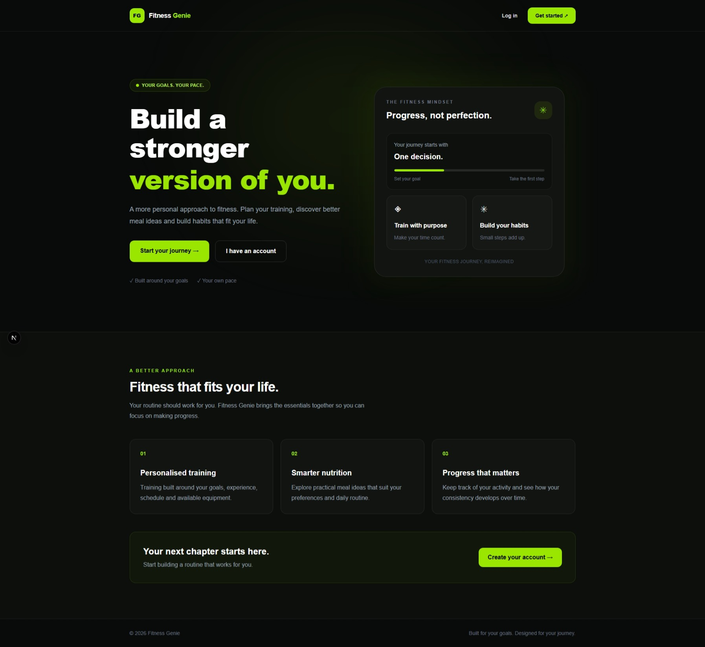
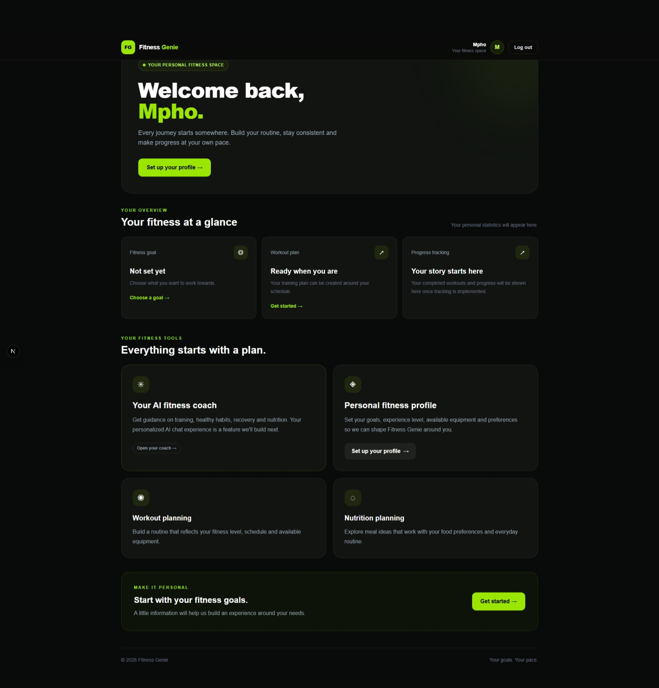
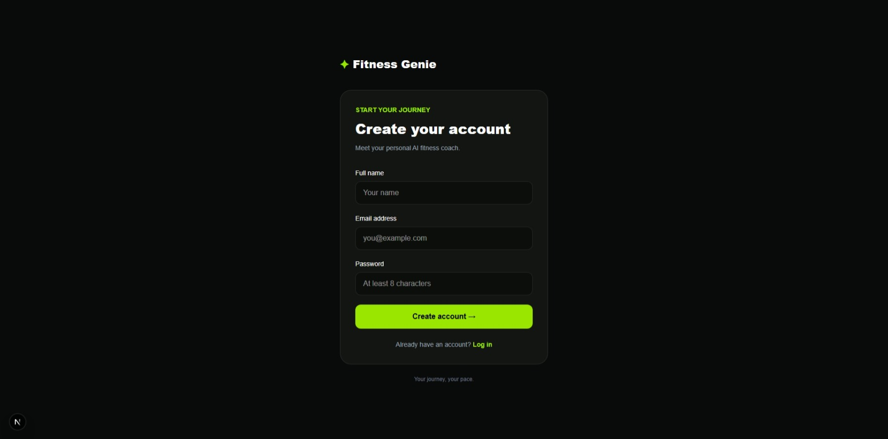
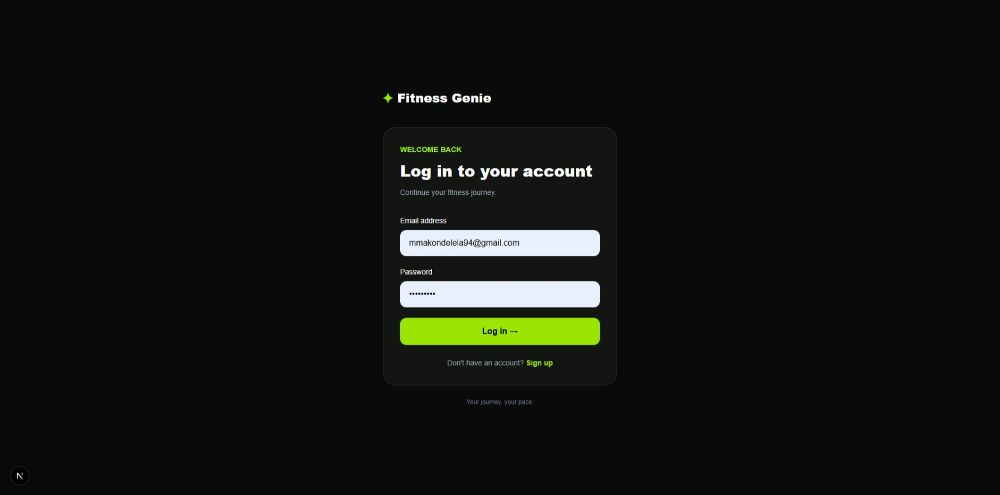
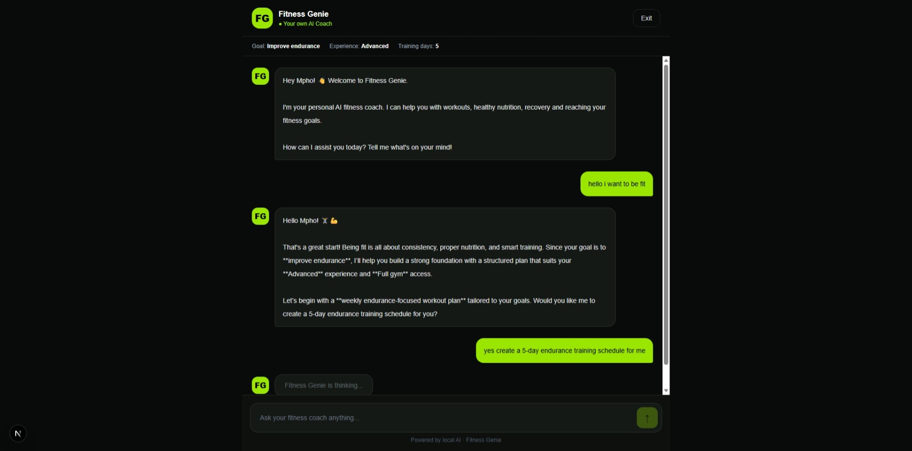

# Fitness Genie 💪

**Your AI-powered personal fitness companion.**

Fitness Genie is a fitness application designed to help users manage their fitness journey through personalised workout programmes and AI-powered coaching.

The application combines a modern web interface, user profile management, and AI integration to provide a more personalised fitness experience.

## 🚀 Features

- **User Authentication:** Secure registration and login using Supabase.
- **Personalised Profiles:** Users can provide fitness information and goals.
- **AI Fitness Coach:** Coach Genie helps users generate personalised fitness programmes.
- **Workout Programmes:** Generate workout plans based on training preferences and experience.
- **Modern Dashboard:** A central place to access the application's features.
- **Docker Support:** Run the application using Docker and Docker Compose.

## 🛠️ Technologies Used

| Technology | Purpose |
|---|---|
| Next.js | Frontend and application framework |
| TypeScript | Type-safe development |
| Tailwind CSS | User interface styling |
| Supabase | Authentication and profile management |
| Google Gemini API | AI-powered coaching |
| Docker | Application containerisation |
| Git & GitHub | Version control and collaboration |

## 📸 Screenshots


| Home Page | Dashboard |
|---|---|
|  |  |

| SignUp | LogIn |
|---|---|
|  |  |

| AI Coach |  |
|---|---|
|   |

## ⚙️ Installation and Setup

### 1. Clone the repository

```bash
git clone https://github.com/MphoMakondelela/fitness-genie.git
```

### 2. Navigate into the project

```bash
cd fitness-genie
```

### 3. Install dependencies

```bash
npm install
```

### 4. Configure environment variables

Create a `.env.local` file in the project root and configure the required environment variables:

```env
NEXT_PUBLIC_SUPABASE_URL=your_supabase_url
NEXT_PUBLIC_SUPABASE_PUBLISHABLE_KEY=your_supabase_publishable_key
GEMINI_API_KEY=your_gemini_api_key
```

Use your own credentials. Never upload API keys or secret environment files to GitHub.

### 5. Start the development server

```bash
npm run dev
```

Open:

```text
http://localhost:3000
```

## 🐳 Running with Docker

If Docker is installed, you can build and run the application using:

```bash
docker pull mmakondelela/fitness-genie:1.0
```

```bash
docker run -p 3000:3000 mmakondelela/fitness-genie:1.0
```

Open `http://localhost:3000` in your browser.

Make sure your Docker environment is configured with the required application variables.

## Using Ollama for the coach

The coach generation route uses Gemini by default. To use a local Ollama model
instead, add these settings to `.env.local`:

```env
AI_PROVIDER=ollama
OLLAMA_BASE_URL=http://127.0.0.1:11434
OLLAMA_MODEL=mistral:latest
```

Make sure Ollama is running and the selected model is installed (for example,
run `ollama pull mistral:latest`). Restart the Next.js development server after
changing environment variables. To switch back to Gemini, set
`AI_PROVIDER=gemini` and configure `GEMINI_API_KEY`.

## 🎯 Project Objective

The objective of Fitness Genie is to demonstrate how modern web technologies and AI integration can be combined to create a personalised fitness application.

The project also provides practical experience in frontend development, backend integration, authentication, API development, and application containerisation.

## 👨‍💻 Developer

**Mpho Makondelela**

Diploma in Computer Science  
Tshwane University of Technology

GitHub: [MphoMakondelela](https://github.com/MphoMakondelela)

Project: [Fitness Genie](https://github.com/MphoMakondelela/fitness-genie)

---

*Fitness Genie — Building a smarter fitness experience.*
